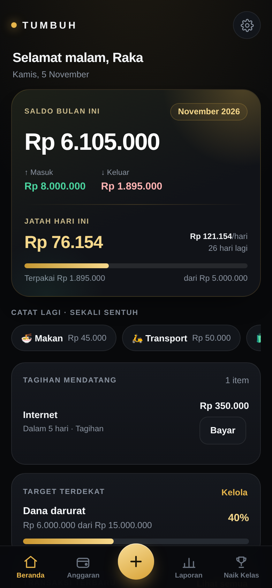

# TUMBUH — Keuangan Naik Kelas

Aplikasi keuangan pribadi berbasis **satu file HTML**. Tanpa server, tanpa database, tanpa akun. Semua data tersimpan di HP kamu.



Dibuat untuk dipakai **3 menit sehari**: catat pengeluaran 3 detik, lihat sisa jatah hari ini, dan biarkan sisanya dihitung otomatis.

---

## Fitur

- **Catat 3 detik** — keypad angka, kategori sekali sentuh, catatan opsional. Ada tombol "Catat lagi" untuk transaksi yang sering diulang.
- **Jatah harian** — dari anggaran bulanan, app menghitung berapa yang boleh kamu belanjakan hari ini dan berapa yang tersisa setelah pengeluaran hari ini.
- **Amplop per kategori** — batasi makan, transport, belanja, tagihan, dan lainnya. Progress bar menunjukkan mana yang hampir habis.
- **Panduan 50/30/20 & 6 Dompet** — pembagian ala T. Harv Eker, lengkap dengan nominal otomatis dari pemasukan bulan ini.
- **Target tabungan** — dana darurat, laptop, liburan. Tombol "Nabung" langsung mencatat transaksi kategori Tabungan.
- **Utang, piutang, tagihan rutin** — pengingat tagihan muncul 7 hari sebelum jatuh tempo.
- **Laporan** — grafik 6 bulan, donut kategori, rata-rata harian, perbandingan bulan lalu, dan ekspor CSV.
- **Naik Kelas** — 8 prinsip uang dari Warren Buffett, Charlie Munger, Ray Dalio, T. Harv Eker, Robert Kiyosaki, Chairul Tanjung, Bill Gates, dan Naval Ravikant. Plus tantangan 7 hari.
- **Offline & bisa dipasang** — PWA. Setelah dibuka sekali, tetap jalan tanpa internet dan bisa masuk home screen HP.
- **Cadangan data** — unduh/salin JSON dari menu Pengaturan, pulihkan kapan saja.

---

## Upload ke GitHub (tanpa terminal, ± 2 menit)

0. **Ekstrak dulu** `TUMBUH-github.zip`. Jangan upload file zip-nya — GitHub hanya menampilkan zip sebagai file, bukan menjalankan app.
1. Buka [github.com/new](https://github.com/new) (login dulu). Buat repository baru, nama misalnya `tumbuh`, pilih **Public**.
2. Di halaman repo, klik **Add file → Upload files**.
3. Buka folder hasil ekstrak, pilih **semua file** di dalamnya (Ctrl+A), lalu tarik ke area upload. Yang di-upload adalah isi folder, bukan foldernya.
   File: `index.html`, `README.md`, `manifest.webmanifest`, `sw.js`, `icon-192.png`, `icon-512.png`, `preview.png` (`.nojekyll` opsional, file tersembunyi).
4. Klik **Commit changes**.
5. Buka **Settings → Pages**.
   - **Source**: `Deploy from a branch`
   - **Branch**: `main` dan folder `/ (root)`
   - Klik **Save**.
6. Tunggu 1–2 menit, refresh halaman itu. Alamatnya menjadi:
   `https://NAMA-USER.github.io/tumbuh/`

> Penting: `index.html` harus ada di root repo, bukan di dalam folder. Kalau URL root menampilkan 404 atau daftar file, cek posisi `index.html`.

### Kalau terjadi masalah

- **404 / "There isn't a GitHub Pages site here"** — Pages belum aktif, branch/folder salah, atau belum 1–2 menit.
- **Yang muncul malah README** — nama file harus tepat `index.html` (huruf kecil), di root repo.
- **URL jadi `/tumbuh/tumbuh/`** — kamu meng-upload foldernya, bukan isinya. Pindahkan file ke root repo.
- **Repo Private** — GitHub Pages untuk repo private butuh paket berbayar. Gunakan **Public**.
- **Perubahan tidak muncul di HP** — tutup tab lalu buka lagi; service worker memakai network-first, jadi versi baru diambil saat online.

### Lewat terminal

```bash
cd tumbuh
git init
git add .
git commit -m "TUMBUH — aplikasi keuangan"
git branch -M main
git remote add origin https://github.com/NAMA-USER/tumbuh.git
git push -u origin main
```

Lalu aktifkan GitHub Pages seperti langkah 5 di atas.

### Pasang di HP

1. Buka alamat GitHub Pages di Chrome (Android) atau Safari (iPhone).
2. Menu browser → **Add to Home screen** / **Instal aplikasi**.
3. Ikon TUMBUH muncul di home screen dan berjalan seperti aplikasi biasa.

PWA hanya aktif lewat `https://` (GitHub Pages sudah otomatis HTTPS). Kalau file dibuka langsung dari HP (`file://`), app tetap jalan, hanya tidak bisa dipasang ke home screen.

---

## Data & privasi

- Semua transaksi disimpan di **localStorage** browser, di perangkat itu saja. Tidak ada server, tidak ada analitik, tidak ada pengiriman data.
- Data bisa hilang kalau kamu menghapus data browsing atau memakai mode incognito. **Rutin unduh backup JSON** lewat Pengaturan.
- Pindah HP: **Pengaturan → Unduh JSON** di HP lama, lalu tempel isinya di **Pengaturan → Tempel JSON** di HP baru.
- Data terikat pada alamat (origin). Kalau kamu membuka file langsung lalu pindah ke GitHub Pages, atau pindah dari `username.github.io/tumbuh` ke alamat lain, unduh JSON dulu lalu pulihkan di alamat baru.
- **Pengaturan → Hapus semua data** menghapus semuanya dari perangkat.

---

## Struktur file

| File | Fungsi |
|---|---|
| `index.html` | Seluruh aplikasi (HTML + CSS + JavaScript). Ini yang dibuka browser. |
| `manifest.webmanifest` | Nama, warna, dan ikon saat dipasang sebagai aplikasi. |
| `sw.js` | Service worker — membuat app tetap terbuka saat offline. |
| `icon-192.png`, `icon-512.png` | Ikon aplikasi. |
| `preview.png` | Tangkapan layar untuk README. |

---

## Dua metode yang dipakai

**50 / 30 / 20** — 50% kebutuhan pokok, 30% gaya hidup, 20% masa depan. Cocok untuk pemula dan yang baru mulai menabung.

**6 Dompet (T. Harv Eker)** — 55% kebutuhan pokok, 10% bersenang-senang, 10% kebebasan finansial (investasi), 10% tabungan jangka panjang, 10% pendidikan, 5% berbagi. Lebih rinci, cocok kalau pemasukan sudah stabil.

Angka ini panduan, bukan aturan mati. Yang penting: **konsisten dan sesuai kenyataan**. Kalau 20% terasa berat, mulai dari 5% — yang penting dimulai.

---

## Mau mengubah

- **Warna aksen**: cari `--gold` di bagian `<style>` pada `index.html`.
- **Nama aplikasi**: ubah `<title>`, `.brand`, dan `name` di `manifest.webmanifest`.
- **Kategori awal**: ubah `DEFAULT_CATS` di dalam `index.html`.
- **Persentase panduan**: ubah angka pada fungsi `guideRows()`.

Setelah mengubah, naikkan versi cache di `sw.js` (`tumbuh-v1` → `tumbuh-v2`) agar perubahan langsung terlihat di HP.

---

## Catatan

TUMBUH adalah alat bantu kebiasaan dan pencatatan, bukan nasihat keuangan atau investasi. Untuk keputusan besar (kredit, investasi, asuransi), tetap konsultasikan dengan ahlinya.

Dibuat untuk dipakai, bukan sekadar dikoleksi. Mulai dari satu transaksi hari ini.
